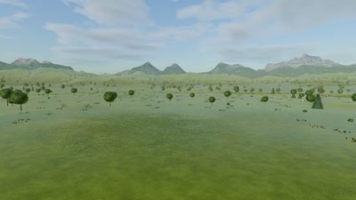
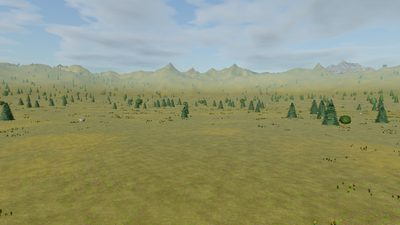
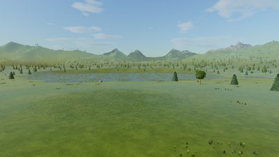
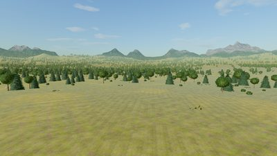
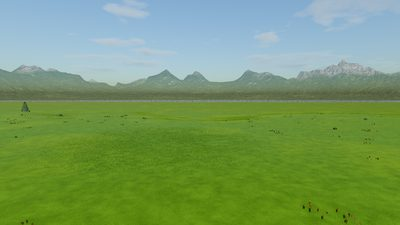
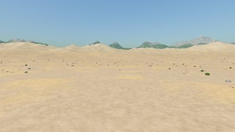
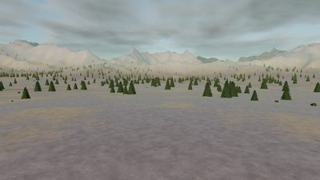
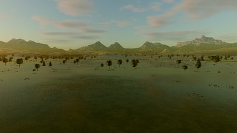
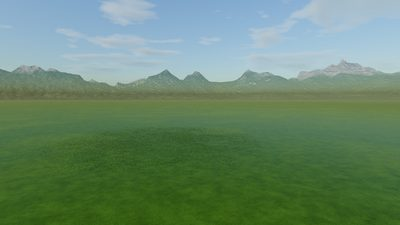

<h1 align="center">Render Mill</h1>

<p align="center">
  <b>Real-time architectural rendering; an independent take on the Lumion workflow, written in pure Rust.</b>
</p>

<p align="center">
  Bring in a building from Revit, SketchUp, ArchiCAD or 3ds Max, drop it on a landscape, dress it with trees, people,
  furniture and lights, paint its surfaces from a library of real-world PBR materials, and walk around it in real time.
  Re-export from Revit and the scene updates in place, keeping your materials, objects and cameras. When the view is
  right, render a ray-traced, AI-denoised photo or a movie.<br>
  <i>By Cerium Built.</i>
</p>

<p align="center">
  
  
  
  
  
  
</p>

<br>

<!-- Hero screenshot: save a capture of the app as docs/images/desktop.png and uncomment.
<p align="center">
  
  <br><sub><b>Build mode</b>: the imported house on a landscape template, the Build dock in the bottom-left and the LiveSync card top-right.</sub>
</p>
-->

<p align="center">
  <a href="#landscape-templates">Landscape templates</a> ·
  <a href="#why-render-mill">Why Render Mill</a> ·
  <a href="#what-works-today">What works today</a> ·
  <a href="#quick-start">Quick start</a> ·
  <a href="#the-desktop-app">The desktop app</a> ·
  <a href="#getting-models-in">Getting models in</a> ·
  <a href="#materials-and-textures">Materials and textures</a> ·
  <a href="#photos-movies-and-ray-tracing">Photos, movies and ray tracing</a> ·
  <a href="#command-line">Command line</a> ·
  <a href="#livesync-protocol">LiveSync protocol</a> ·
  <a href="#performance">Performance</a> ·
  <a href="#architecture">Architecture</a> ·
  <a href="#downloads">Downloads</a> ·
  <a href="#license-and-credits">License and credits</a>
</p>

## Landscape templates

**Create new** on the start screen offers nine landscapes. Each is real terrain with thousands of trees, shrubs, rocks,
wildflowers and tall grass, and its own sky, sun and haze; the building plot in the middle is always flat and clear.

<table>
  <tr>
    <td width="33%"></td>
    <td width="33%"></td>
    <td width="33%"></td>
  </tr>
  <tr>
    <td><sub><b>Green meadow</b></sub></td>
    <td><sub><b>Mountain valley</b></sub></td>
    <td><sub><b>Lakeside</b></sub></td>
  </tr>
  <tr>
    <td></td>
    <td></td>
    <td></td>
  </tr>
  <tr>
    <td><sub><b>Forest clearing</b></sub></td>
    <td><sub><b>Coast</b></sub></td>
    <td><sub><b>Desert</b></sub></td>
  </tr>
  <tr>
    <td></td>
    <td></td>
    <td></td>
  </tr>
  <tr>
    <td><sub><b>Winter</b></sub></td>
    <td><sub><b>Golden hour</b></sub></td>
    <td><sub><b>Flat lawn</b></sub></td>
  </tr>
</table>

## Why Render Mill

- **The workflow you know.** Lumion's layout and habits: a thin title bar, a narrow icon sidebar, a full-screen
  viewport, the Build dock with its category grid, the material editor's value bars, Photo mode's effect stack and
  filmstrip, Movie mode's clips and keyframes, and the same WASD/QE/RMB navigation.
- **Live from Revit, no add-in.** FBX is Revit's built-in export. Point Render Mill at the file or the folder, export
  again after each change, and only the parts of the model that changed are re-uploaded. Material edits stick by name
  across every re-sync.
- **Opens what you already have.** FBX, COLLADA (`.dae`), glTF/GLB and OBJ models, Lumion scenes (`.lsf`, `.lqf`) and
  imported-model files (`.lib`), and your own texture folders indexed in place.
- **Photographic output.** A GPU path tracer with global illumination, true reflections and refraction, light through
  glass and real lens depth of field, cleaned up by Intel Open Image Denoise, with an AgX filmic curve. It runs on any
  DirectX 12 or Vulkan card; RTX cores aren't needed.
- **Scriptable.** Command-line renders, movies and benchmarks without a window, and a small TCP protocol that
  BimCraft, scripts or anything else can push meshes over.
- **Fast and native.** Pure Rust on wgpu and egui: no Electron, no web view, no frames drawn when nothing changes.
- **Local.** No account, no cloud service. Match-from-photo and the denoiser run on your own computer.

## What works today

Render Mill is in early, fast development. Honest status:

| Area | Works today |
|---|---|
| Start screen | Create new (nine landscape templates), Example (a demo house), Load, Start from a Revit / 3D model, and recent projects |
| Model import | FBX (binary 7.x including 64-bit 7.5+, and ASCII), COLLADA `.dae`, glTF/GLB and OBJ; units and up axis read from the file and overridable; node hierarchies, instances and per-object materials; import as the live-synced **building** or as a placeable **library object** |
| LiveSync | Watch a file or a folder (newest export wins); chunked re-sync re-uploads only changed geometry; materials, objects and cameras survive every re-sync; TCP server on `127.0.0.1:47811` for BimCraft and scripts, with a pairing code for other computers |
| Lumion files | Scenes (`.lsf`, `.lqf`): imported models in place, their material settings, saved cameras and the sun. Library objects become Render Mill's nearest object; library materials become the closest library material; `.lib` imported models open like any model. Read-only |
| Objects | About 70 photo-scanned CC0 models (trees, plants, rocks, furniture, lamps, decor) plus procedural trees, conifers, shrubs, planters, boulders, people, cars, benches and street lamps; place one, paint along a path or mass-place; move, height, rotate and scale selections; your own FBX/OBJ/glTF kept for every project |
| Lights | Point and spot lights and working street lamps, up to 256 |
| Materials | About 270 CC0 PBR materials in 23 categories; Standard, Glass, Water, Emissive, Foliage and Landscape types; colour, texture, map scale, relief, roughness, reflectivity, metalness, opacity, glow, cut-out and weathering; real-world texture mapping in metres; your own folders and dragged-in images grouped into colour/normal/roughness sets |
| Match from photo | Split a photo of a house into its materials (siding, brick, roof, trim, paving), find the closest library textures for each, and apply them to the model's materials |
| Landscape and weather | Terrain templates, mountain backdrop, about 700k blades of 3D grass, six photo-textured ground types; physically based sky with ray-marched clouds; midday, golden hour, overcast, morning, dusk and night |
| Photo mode | Effect stack (colour correction, sky light, fog, shadow, reflection, bloom, vignette, sharpen, depth of field, chromatic aberration, film grain, auto exposure, screen-space reflections); framed preview with camera bar; 10-slot photo set; HD to 8K, checked against the card's limits first |
| Ray tracing | Fast / High / Ultra / Max (16 to 1024 samples per pixel); live ray-traced preview while the camera is still; AI denoiser on CPU or CUDA, with a wavelet fallback |
| Movie mode | Clips as camera paths through keyframes; preview and scrub; 720p to 4K at 24, 30 or 60 fps; PNG frames, and MP4 when `ffmpeg` is available; ray-traced frames optional |
| Projects | `.lcproj` (JSON): scene, materials, objects, views, clips, landscape and environment |

## Quick start

Render Mill builds with stable Rust (2021 edition) on wgpu 22 and egui 0.29.

```sh
git clone https://github.com/BManning94/Render-Mill
cd Render-Mill
cargo run --release              # opens the start screen
```

Open a model, a folder of exports or a project straight away:

```sh
cargo run --release -- model.fbx          # open and live-sync a model
cargo run --release -- C:\Renders\MyHouse # watch a folder, always showing the newest export
cargo run --release -- house.lcproj       # open a saved project
```

Without a window:

```sh
cargo build --release
./target/release/RenderMill --render --demo house.png --size 1920x1080 --preset "Golden hour" --raytrace high
```

That renders the demo house at golden hour, path traced and denoised. The built-in material library, the 3D models and
the denoiser ship as separate downloads (see [Downloads](#downloads)); a source build without them falls back to
procedural objects and the wavelet denoiser.

## The desktop app

The layout follows Lumion 2025: a thin custom title bar, a narrow icon sidebar on the left, a full-screen viewport, and
flat charcoal panels floating over it.

- **Title bar.** Project name, a frame-rate gauge (green, amber or red, with GPU time on hover), quality stars (F1–F4),
  and minimise / maximise / close. Drag to move, double-click to maximise, drag the edges to resize.
- **Left sidebar.** File, Build mode, Photo mode, Movie mode and Imported model / LiveSync; at the bottom the Activity
  log, Settings (quality, auto-resolution, walk speed, graphics card, texture memory, library folders, LiveSync server)
  and Help.
- **View pill and search** (top-left). Saved views and Frame model; the round button opens the object library with the
  search box focused.
- **LiveSync card** (top-right). A green dot means a live file or BimCraft link; the power button pauses, resumes or
  imports. Under it, the imported-model card (thumbnail, replace, reload, import settings). In the Delete tool it becomes
  **Selected objects** with a red bin.
- **Build dock** (bottom-left), with Home, Materials, Landscape and Weather tabs:
  - **Home:** a 2×4 category grid (Nature, People, Transport, Interior, Exterior, Lights, Favourites, All), Select all,
    and the tools: Place (single, paint, mass), Select (move, height, rotate, scale) and Delete (single, area), with
    random rotation and size.
  - **Object library:** search, category and sub-category icons, a breadcrumb and a thumbnail grid; hover for a preview
    card with tags and a favourite star; click an item, then click in the view.
  - **Properties:** position, heading, size and light settings beside the dock. Selected objects get a yellow box and
    an axis gizmo.
- **Material editor** (brush tab). Hover a surface to see its name, click to edit it (it tints blue). Library and
  Settings tabs; value bars for colour, texture, map scale, relief, roughness, reflectivity and metalness; map swatches
  with large previews; Advanced, Placement, Weathering and Imported material sections; copy and paste material. The blue
  ✓ keeps the changes, ✕ discards them.
- **Photo mode.** Style menu and *+ Add effect* on the left, each effect with an eye toggle; a framed preview with focal
  length, heading, pitch, aspect ratio and camera lock under it; a 10-slot filmstrip; a big blue Render button.
- **Movie mode.** Clips along the bottom, **+ Keyframe**, play and scrub, right-click a keyframe to update or delete it.
- **Shortcut hints** run down the right edge and expand into labels while you navigate.

| Input | Action |
|---|---|
| RMB drag | Look around |
| WASD / arrows, Q / E | Move, down / up |
| Shift / Space / both | Fast / slow / extra fast |
| O + RMB drag | Orbit around the point in the screen centre |
| MMB drag / Wheel | Pan / dolly |
| F | Frame the model |
| LMB | Pick a material, or place an object or light |
| M / H / R / L | Move / height / rotate / scale the selection |
| Ctrl+click, Ctrl+A, Esc | Add to selection, select all, deselect |
| Delete | Delete the selection |
| Ctrl+Z / Ctrl+Y | Undo / redo |
| Ctrl+S | Save project |
| Ctrl+1..9 / Shift+1..9 | Store / recall a camera |
| F1–F4 | Viewport quality |

## Getting models in

### Revit, live

FBX is Revit's built-in export, so no add-in is needed.

1. In Revit, **File → Export → FBX** into a folder, for example `C:\Renders\MyHouse\model.fbx`.
2. In Render Mill, **Import model…** (or **Watch folder…**, which always shows the newest file there) and choose
   **building**.
3. Edit materials, place objects and lights, set up views.
4. Change the design in Revit and export over the same file. Render Mill reloads it and keeps your materials, objects
   and camera.

The model is split into spatial chunks and only changed chunks go back to the GPU; the activity log says "N of M chunks
changed". Revit's feet and Z-up are read from the file. Revit still needs the export click: updating without one would
take a Revit add-in, and those must be written in .NET.

### COLLADA, glTF and OBJ

COLLADA `.dae` is what Lumion LiveSync for Revit, SketchUp, ArchiCAD and 3ds Max export. Render Mill reads its units, up
axis, node hierarchy, instances, colours, textures, transparency and shininess, and from Lumion's Revit exporter also
albedo, normal and roughness maps, reflectiveness and material type. A `.dae` imported as the building is watched like
an FBX. glTF/GLB (Y-up metres) and OBJ (Z-up feet by default) work too; override either under **LiveSync → Import
settings**.

### Lumion files

**File › Open project**, the start screen's **Load**, or drag a file onto the window:

- **Scenes (`.lsf`, quick-save `.lqf`):** your imported models where you placed them, their material settings (tints,
  roughness, metalness, transparency, your own textures), every saved camera and the first key of each movie clip, and
  the sun.
- **Library objects** are Lumion's licensed content and aren't copied: each is replaced by Render Mill's nearest object
  at the same spot, size and rotation. Library materials become the closest Render Mill material by name and kind. Grass
  clumps, landscape paint, text and effects are left out, and the activity log lists what wasn't brought over.
- **Imported-model files (`.lib`)** from Lumion's library folder open like any other model.

The format isn't published; it was worked out from your own files. Everything is read, nothing is changed.

### Textures in models

Textures are found embedded in the FBX, next to the model or in its `.fbm` folder, in texture folders you add under
Import → Texture folders, or in the Autodesk material library for Revit's own materials. Absolute paths from the
exporting computer are matched by file name, and by the same name with another image extension. PNG, JPG, TGA, BMP, TIF,
GIF, WebP and DDS; colour, normal (or bump converted to normal) and opacity cut-outs, with the FBX's tiling and offset.
Anything referenced but missing is listed in the Import panel.

## Materials and textures

- **Built-in library.** About 270 CC0 PBR materials from ambientCG in 23 categories (brick, tiles, wood, wood floor,
  siding, concrete, paving, stone, marble, metal, roofing, plaster, fabric, ground, asphalt and more), each with colour,
  normal and roughness maps and a real-world size; *Basic* holds glass, water and light.
- **Your folders.** Added under Settings › Material library folders and indexed in place, nothing copied. Each
  sub-folder becomes a material named after it; `-COLOR-`, `-NORMAL-`, `-ROUGHNESS-` and `-GLOSS-` files are recognised,
  as in manufacturer and Arroway-style packs; categories are guessed from the name.
- **Your images.** Material editor → Library → Custom → Images… or Folder…, drag files or folders onto the window, or
  Choose… in a map slot. Files sharing a base name become one set: Poly Haven (`_diff_4k`, `_nor_gl_4k`, `_rough_4k`),
  ambientCG (`_Color`, `_NormalGL`, `_NormalDX`, `_Roughness`) or generic (`_albedo`, `_basecolor`, `_normal`,
  `_gloss`). DirectX normals and gloss maps are converted.
- **Real-world mapping.** Library textures are laid in metres on every face instead of trusting the model's UVs, which
  Revit often leaves missing, stretched or in feet. Turn it off per material under Placement for a carefully UV-mapped
  model.
- **Match from photo.** Materials tab or File menu. Pick a photo of a house; Render Mill splits it into regions, lists
  the closest textures for each with a similarity score, points each region at the model material whose name fits, and
  **Apply all** puts them on. It runs locally on colour and texture analysis; treat matches as suggestions.

## Photos, movies and ray tracing

Photo mode › Render › **Ray tracing**: Off, Fast (16 samples per pixel), High (64), Ultra (256) or Max (1024).

- **Path tracer.** A GPU compute path tracer over a SAH BVH: global illumination, soft sun shadows, mirror and glossy
  reflections, refraction and absorption in water, sunlight tinted and reduced through glass, translucent leaves, alpha
  cut-outs, emissive materials and every placed light. Same materials, sky, sun and fog as the rasterizer, so it's a
  switch, not a different look.
- **AI denoiser.** Intel Open Image Denoise, guided by albedo and normal layers, on the CPU or through CUDA on NVIDIA;
  an edge-aware wavelet filter if the `denoiser` folder is missing.
- **Live preview.** While the camera is still, Photo mode's preview refines itself at 1, 2, 4, 8… samples, read back and
  denoised off the UI thread.
- **Camera.** AgX filmic tone curve by default (ACES available), thin-lens depth of field with round bokeh, 1.5–2×
  supersampling for final renders.
- **Sizes.** Checked against the graphics card's texture, buffer and binding limits before a render starts; if a size
  won't fit, the popup says why and offers the largest that will.
- **Movies.** Every frame rendered at the highest quality or path traced; clouds, water and plants animate over the clip.

## Command line

```text
RenderMill                                  open the start screen
RenderMill <model|folder|project.lcproj>    open a model, watch a folder, or open a project
RenderMill <photo.jpg>                      start with Match from photo
RenderMill --render <input|--demo> <out.png> [--size 1920x1080] [--view N]
           [--preset "Golden hour"] [--camera ex,ey,ez,tx,ty,tz]
           [--raytrace fast|high|ultra|max|<samples>] [--no-denoise]
RenderMill --movie <input|--demo> <out-folder> [--size 1280x720] [--fps 30] [--seconds 8]
RenderMill --match-photo <house.jpg> <texture-folder> [overlay.png]
RenderMill --bench <model|--demo> --quality 1-4
RenderMill --bench-pt <small-exterior|large-exterior|interior|large-model|all> [--size 1280x720] [--spp 64] [--out DIR]
RenderMill --bench-preview [scene] [--size WxH] [--seconds N] [--out FILE]
```

Examples:

```sh
RenderMill --render model.fbx out.png --size 3840x2160
RenderMill --render project.lcproj out.png --view 0
RenderMill --render --demo out.png --preset "Golden hour" --camera 10,1.7,20,-2,2.5,5
RenderMill --render model.fbx out.png --raytrace ultra
RenderMill --movie project.lcproj frames --size 1920x1080 --fps 30
```

On Windows, release builds attach to the terminal they're started from, so command-line renders print progress and
errors. `Measure-Viewport.bat` and `Measure-Preview.bat` beside the executable record frame and preview times on your card.

Environment variables keep their original `LUMENCRAFT_` names:

| Variable | Effect |
|---|---|
| `LUMENCRAFT_GPU` | Pick the graphics card by name for one run (e.g. `3090`); otherwise the Settings choice is used |
| `LUMENCRAFT_PT_TEXTURE_MB` | Ray-tracing texture budget in MB (default 3072) |
| `LUMENCRAFT_TEXTURE_MB` | Viewport texture budget in MB (default 2048) |
| `LUMENCRAFT_WINDOW_SAMPLING` | `1` aims sky light through glazing: less noise indoors, about twice the cost per sample (experimental) |
| `LUMENCRAFT_LIBRARY` | Location of the built-in material library |
| `LUMENCRAFT_OIDN` | Location of the Open Image Denoise library |

## LiveSync protocol

The server listens on `127.0.0.1:47811`. Tick **Allow other computers on the network** and remote clients must send
the pairing code shown in the panel; local connections never need it. A remote client can't make Render Mill read
local files, and frames are capped at 256 MB.

The spec and a client are in [`src/protocol.rs`](src/protocol.rs), which depends only on serde, so BimCraft or any other
host can copy it as-is. Meshes are upserted by element id, so a host only sends what changed. `rendermill-sync` is the
reference client:

```sh
rendermill-sync model.fbx --watch
rendermill-sync model.fbx --addr 192.168.1.20:47811 --token 123456-789012
rendermill-sync model.obj --units ft --up z
```

## Performance

- **Viewport quality, 1 to 4 stars** (F1–F4). Photos always render at level 4.

  | Level | MSAA | Shadow maps | Other |
  |---|---|---|---|
  | 1 | Off (FXAA) | 1K | No SSAO, no grass |
  | 2 | Off (FXAA) | 2K | Light SSAO, reflections available |
  | 3 | 4× | 2K | Full lighting |
  | 4 | 4× | 4K | Maximum (default on a dedicated card) |

- **Auto resolution** drops the render size while the camera or an object moves and the frame rate falls, and snaps
  back the moment you stop.
- **No wasted frames.** Nothing changes, nothing is drawn; only clouds and water moving caps the view at 30 fps.
- **Renderer.** Cached cascaded shadow maps (far cascades refreshed less often while moving), no ground in shadow
  maps, sky only where visible, front-to-back opaque draws with a depth pre-pass, reverse-Z with an infinite far plane.
- **Texture budget.** A hard limit for the viewport and ray tracing: the largest maps step down first, to 128 px, then
  normal/roughness maps, then colour maps, and you're told whenever quality is reduced. **Settings › Texture memory**
  shows usage and has a slider.
- **External GPUs.** Ray-traced work is queued asynchronously in short passes sized from GPU timestamps, so the viewport
  stays responsive over Thunderbolt and never trips the Windows GPU timeout. **Settings › Graphics card** picks the eGPU
  or the laptop GPU by name.

## Architecture

```text
src/main.rs            command-line entry: the window, or --render, --movie, --match-photo and the benchmarks
src/lib.rs             the library crate (lumencraft) everything else lives in
src/scene.rs           the scene the importers, LiveSync and the renderer share: Y-up, metres
src/import.rs          model import: FBX, glTF/GLB and OBJ, the files the watcher reloads
src/fbx.rs             FBX reader: binary 7.x (64-bit 7.5+ headers) and ASCII, hardened against damaged files
src/collada.rs         COLLADA (.dae) reader
src/lumion.rs          Lumion scenes (.lsf, .lqf) and imported-model files (.lib, .lib.lms), read-only
src/sync.rs            LiveSync: the file and folder watcher, and the TCP server
src/protocol.rs        the LiveSync wire protocol (v1); serde only, copyable into any host
src/project.rs         .lcproj projects and the world that ties scene and settings together
src/env.rs             camera, weather, sun and effects, and their renderer parameters
src/landscape.rs       landscape templates: terrain, scattered vegetation, sky and sun
src/objects.rs         the object library: scanned models and procedural trees, people, cars, lamps
src/library.rs         libraries on disk: the built-in CC0 materials and models, settings
src/texlib.rs          the user's texture library, grouped into colour/normal/roughness sets
src/mips.rs            texture resampling and mip chains shared by the rasterizer and the path tracer
src/renderer.rs        the wgpu rasterizer: atmosphere LUT, cascaded shadows, MSAA HDR, SSR, bloom, exposure,
                       SSAO, depth of field, lens and tone mapping
src/pathtrace.rs       the GPU path tracer for photos, movies and the live preview; GPU limits and texture plans
src/bvh.rs             binned-SAH bounding volume hierarchy, flattened for the GPU
src/preview.rs         the live ray-traced preview in Photo mode
src/denoise.rs         Open Image Denoise, and the wavelet fallback
src/photomatch.rs      Match from photo: regions and nearest library textures
src/headless.rs        rendering without a window
src/bench.rs           reproducible benchmark scenes
src/demo.rs            the demo house
src/shaders/           WGSL: scene, sky, shadow, post, bloom, depth copy, path tracing and its resolve
src/app/               the desktop app: window chrome, start screen, Build dock, material editor, import dialog,
                       Photo mode, Movie mode, Match from photo, ray-traced rendering
src/ui/                theme, vector icons, custom widgets, engine-rendered library thumbnails
src/bin/rendermill-sync.rs  the reference LiveSync client
tests/                 FBX (well-formed and malformed), BVH stress, GPU-vs-CPU traversal, window sampling,
                       texture detail and mapping, LiveSync, incremental re-sync, offline WGSL validation
vendor/egui-wgpu       a patched egui-wgpu
dist/                  Measure-Viewport.bat and Measure-Preview.bat
docs/                  engineering notes for 0.11 and 0.12
```

The crate is still named `lumencraft`; the binaries are `RenderMill` and `rendermill-sync`. Damaged imports show an
error instead of crashing, and a card that runs out of memory mid-render is caught and reported. `cargo fmt --check`
and `cargo clippy --all-targets` are kept clean. Engineering notes and benchmarks are in
[docs/v0.11-engineering-report.md](docs/v0.11-engineering-report.md) and
[docs/v0.12-engineering-notes.md](docs/v0.12-engineering-notes.md); release notes are in [CHANGELOG.md](CHANGELOG.md).

## Roadmap

Done: the Lumion 2025 layout, FBX/glTF/OBJ LiveSync with chunked re-sync, the TCP protocol and BimCraft link, the object
and material libraries, real-world mapping, physically based sky and clouds, 3D grass, Photo and Movie modes, GPU path
tracing with an AI denoiser and a live preview, GPU limits and texture budgets, the start screen and landscape
templates, Match from photo, Lumion scene import and COLLADA.

Not yet: updating from Revit without an export click (that needs a .NET Revit add-in), and tested builds for Linux and
macOS (the code is cross-platform through wgpu, but releases are for Windows).

## Downloads

Releases are Windows x64 zips. Extract every part into the same place ("Extract here"); together they make one folder
holding `RenderMill.exe`, `library\` (materials), `models\` (3D objects) and `denoiser\`.

| Part | File |
|---|---|
| The app | `render-mill-<version>.zip` (`lumencraft-<version>.zip` up to 0.13.0) |
| Material library | `lumencraft-library-…-0.7.0.zip` parts |
| 3D models | `lumencraft-models-…-0.7.0.zip` parts |
| AI denoiser | `lumencraft-denoiser-…-0.8.0.zip` parts; the large DLL is split in two and joined the first time you render |

**Updating:** extract the newest `render-mill-<version>.zip` over the same folder. The library, models and denoiser
don't change between releases. Coming from LumenCraft, your settings (library folders, graphics card, recent projects,
texture budget) move to `%APPDATA%\Render Mill` on first start; `.lcproj` projects open as before, and the old
`lumencraft.exe` can be deleted once `RenderMill.exe` works.

For MP4 output from Movie mode, put `ffmpeg.exe` beside `RenderMill.exe` or on your PATH.

### Building from source

```sh
cargo build --release
cargo test
cargo build --release --target x86_64-pc-windows-gnu   # cross-compile for Windows from Linux
```

## License and credits

<!-- Add a LICENSE file and name it here. -->
Copyright (c) 2026 Cerium Built.

Bundled content keeps its own licence:

- **Materials:** about 270 PBR materials from [ambientCG](https://ambientcg.com), CC0.
- **3D models:** about 70 photo-scanned models from [Poly Haven](https://polyhaven.com), CC0, reduced for real-time use.
- **Denoiser:** [Intel Open Image Denoise](https://www.openimagedenoise.org), Apache-2.0.
- **Rust crates:** wgpu, egui/eframe, glam, gltf, tobj, image, notify, serde and others, under their own licences (see
  `Cargo.lock`); `vendor/egui-wgpu` is a patched copy of egui-wgpu (MIT OR Apache-2.0).

Render Mill never copies Lumion's licensed library content: objects and materials in a Lumion scene are replaced by Render
Mill's own.

<sub>Lumion is a trademark of Act-3D B.V. Autodesk, Revit, FBX and 3ds Max are trademarks or registered trademarks of
Autodesk, Inc. SketchUp is a trademark of Trimble Inc. ArchiCAD is a trademark of Graphisoft SE. Render Mill is an
independent project and is not affiliated with, sponsored by or endorsed by any of them; these names are used only to
describe the workflow it follows and the files it reads.</sub>

<p align="center">
  <sub>Made by Cerium Built, in pure Rust.</sub>
</p>
